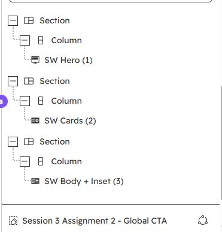
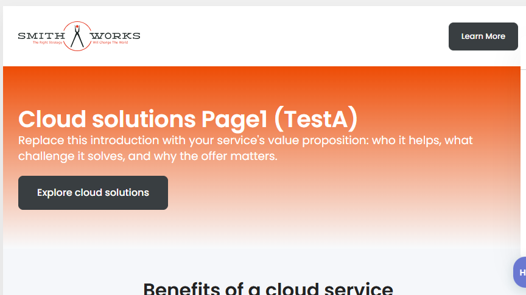
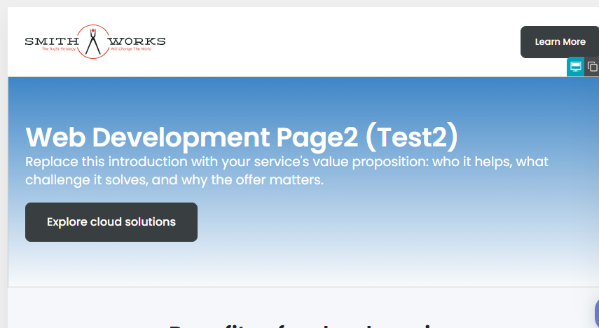
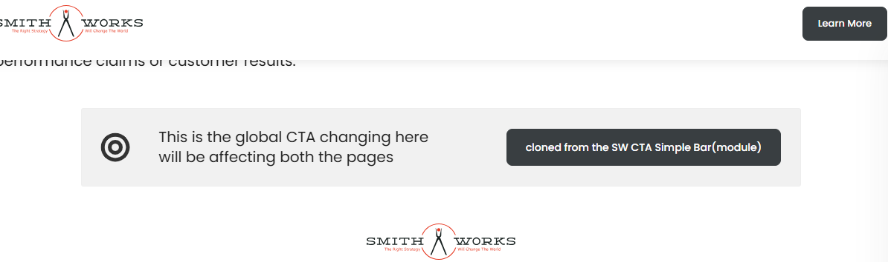

# HubSpot Session 3 Assignment 2

## Assignment Objective

- Build a reusable service landing page template using the existing Smithworks theme.
- Add an editable hero, benefit cards, service details, and a separate global call-to-action (CTA).
- Show that ordinary page content can be edited per page while global content can be shared.

## Steps Followed

- Inspected the backed-up `original-backup/SW Service Page.html` and the Smithworks module references in `module-references/`.

- Reused the existing SW Hero, SW Cards, and SW Body + Inset modules. Checked their `fields.json` files before choosing field names and values.

- Prepared the page template in `working/ITT Training - Service Landing Page - Niraj.html` and the CTA partial in `working/partials/ITT Training - Shared Service CTA - Niraj.html`.

- Updated references so the nested template can reach existing Smithworks modules, header/footer partials, images, CSS, and JavaScript. Pointed the CTA to its new sibling `partials` folder.

- Checked that both remote destinations were unused. Uploaded the CTA first, then the template, to the staging account:

  ```powershell
  hs cms upload "working/partials/ITT Training - Shared Service CTA - Niraj.html" "smithworks/Niraj-ITT-Training/Session-3/Assignment-2/partials/Session3-Assignment2-Global-CTA.html" --account=staging-environment
  hs cms upload "working/ITT Training - Service Landing Page - Niraj.html" "smithworks/Niraj-ITT-Training/Session-3/Assignment-2/templates/Session3-Assignment2-Service-Landing.html" --account=staging-environment
  ```

- Confirmed both files appeared in their remote folders with `hs cms list` using `--account=staging-environment`.

## Concepts Learned

- A **theme** holds shared site design files, such as templates, modules, partials, images, CSS, and JavaScript.
- A **template** is a starting layout for a page. Here it contains three editable content sections.
- A **module** is a reusable content component. Its **fields** define what a marketer can change, such as headings, text, buttons, and layout choices.
- **HubL** is HubSpot's template language. It connects templates to modules, assets, and shared partials. A successful upload alone does not prove that HubL compiles.
- **DND** means drag-and-drop. DND areas contain sections, columns, rows, and modules that can be arranged in the page editor.
- A **global partial** is shared wherever it is included. Changing it can update every page that uses it.
- Page modules are page-specific: changing their copy on one page should not change another page.

## Why We Made These Choices

- Reusing Smithworks modules keeps the page consistent with the existing theme and avoids rebuilding components that already exist.
- The new CTA is an isolated global partial, so it can be shared by assignment pages without changing the site's existing global header or footer.
- Keeping `original-backup/` and `module-references/` unchanged protects the source material and makes it easier to compare or recover the work.
- The CTA was uploaded before the template because the template refers to it.

## Testing & Verification

- **Completed:** Checked module fields and local template structure; confirmed referenced Smithworks assets; checked that destination paths were unused before upload; uploaded the CTA and template, then updated and verified the CTA upload.
- **Issue fixed:** The CTA was static HTML, so it had no editable item in the page editor. I replaced it with a DND area using the existing SW CTA Simple Bar module. A remote fetch matched the updated local CTA file.
- **Completed:** Check HubSpot compilation, preview, and whether the CTA now appears in the page editor. The upload is verified, but the page editor has not been checked after this fix.

  
- **Completed:** Create two unpublished pages from the template. Change ordinary module content on one and confirm the other stays unchanged.

  
- **Completed:** Edit the global CTA and confirm the change appears on both pages.
- 

  
- **Completed:** Check desktop, tablet, and mobile layouts for readable text, correct card stacking, and overflow.
- **Completed:** Create a fresh unpublished page and confirm the template's default content and settings load correctly.
- No pages were created or published during this work.

## Key Takeaways

- Check a module's fields before using it in a template.
- Relative paths depend on where a file is stored, so recalculate them when the template moves.
- Upload shared dependencies before the template that uses them.
- A remote file listing confirms storage, not successful compilation or correct editor behavior.
- Test page-specific content and shared global content separately.